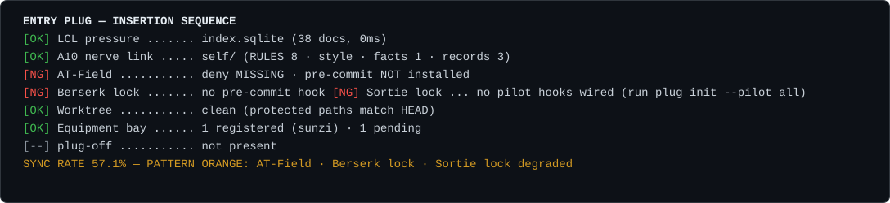

English | [简体中文](README.zh-CN.md)

# entryplug · Entry Plug

## In plain words

EntryPlug is a governance layer for AI coding agents (Claude Code, Codex and Antigravity): a single pure-Rust CLI (`plug`) plus a read-only MCP server (zero Python or runtime dependencies). One person writes down their rules, facts and past decisions; the agent searches them over MCP and works from them. EntryPlug's job is to keep the agent from changing them, and from sending anything out in that person's name without asking first.

Both limits are enforced in code, not in the prompt:

- **Protected files.** A unified `PreToolUse` worktree lock (across Claude Code, Codex and Antigravity), Claude Code `permissions.deny`, and a Git `pre-commit` hook refuse edits and commits to the person's rules, facts, `plug.yaml` and approved tools. The agent writes a Unified Diff refit request instead; only the owner can apply it.
- **Outbound actions.** The same `PreToolUse` hook (`plug gate pretool`) refuses common outbound write commands (`git push`, `gh`, HTTP POST, mail, publish and send tools), verified in Claude Code, Codex and Antigravity. It is a tripwire, not a sandbox: code outside its list can still reach the network.

Measured (details in [How it is measured](#how-it-is-measured)): release binary is **3.05 MB** (3,399 production Rust LOC); retrieval recall@10 is **0.98** on the public 50-case gold set with zero external segmenter; the locks, gates, concurrency, and no-leak ratchets pass `cargo test --offline` in ~6 s. In a private blind benchmark, answers with EntryPlug were preferred on all six situations for each of four agent models (one judge, situations chosen by the author; caveats below).

The rest of this README uses the project's own vocabulary: the agent is the **pilot**, the person's notes are the **Base**, their tools are **Equipment**, and the two limits are the **berserk lock** and the **sortie lock**.

---

entryplug is the plug that lets a coding agent work from one person's written judgment without ever rewriting it. Three file shapes, one read-only search interface, two machine-enforced locks, one self-check. It does not judge, it does not orchestrate, and it does not learn on its own. A Sunzi example equipment ships with it, so the automated acceptance suite and a reproducible benchmark both run in five minutes. This is something I use myself. It is not a general-purpose product.

*Entryplug is the plug any pilot (Claude Code, Codex or Antigravity) inserts into one person's **Base** (rules, records, memory, facts) to fight with that person's **Equipment** (tools). The owner never pilots; the pilot never edits the Base. The pattern is called **Base and Equipment**.*

<picture>
  <source media="(prefers-color-scheme: dark)" srcset="docs/architecture-en-dark.svg">
  
</picture>

Three things are measured, three separate ways, and never mixed into one number:

- Retrieval runs against a **public gold set** of 50 cases anyone can rerun: recall@10 is 0.98 (Chinese 0.96, English 1.00).
- The locks, gates, concurrency, and no-leak ratchets run in `cargo test --offline` (6/6 Rust integration & ratchet suites, plus live 4-step `plug check --contact` across Claude Code, Codex, and Antigravity).
- A **private blind benchmark** runs on the owner's own situations, registered as hashes: the equipped answer was the blind pick on all six situations for each of four different pilots (95% interval 0.61 to 1.00).

## What it does (all of it is in the machine; the content is never here)

| verb | what it does |
|---|---|
| `plug index [--full] [--books]` | walks the content repo in parallel (rayon), validates shapes, chunks, and indexes pure CJK 2-grams + lowercased ASCII into Schema v2 `.kb/state.sqlite` (contentless 2-column FTS5 with 20× title boost) and optional cold `.kb/books.sqlite`; writes the bounded Active-Heads `index.md` (<=50 KB) and each equipment's `playbooks/INDEX.md`, and mirrors manuals into pilot skill dirs |
| `plug search` / MCP `search` | strictly read-only (`SQLITE_OPEN_READ_ONLY`): multi-query round-robin merge, alias expansion, scopes (`tools` · `corpus` · `books` · `logs` · `memory` · `all`), Active Heads default (`--history` shows superseded records), `--view compact\|spine`, date/series/tool/kind filters. **No reranking**: reading the window and weighing it is the pilot's job. Never writes on MCP; surfaces staleness ahead of hits |
| `plug status [--emit] [--json]` | boot self-check across 7 layers (index, Base, AT-Field, berserk lock, sortie lock with exact matcher audit, Worktree vs `HEAD`, equipment bay) plus `.plug-off`, `Records due`, and `Review due`. Exits nonzero only when the index itself is unusable |
| `plug check [--contact <pilot>]` | check-up: ERROR / WARNING one line at a time, shape v1/v2 validation, quote & rule-id verification, tracked-clean equipment `checks/*.py`, 30-day proposal expiry, revived decision-only `self/数字.md` (with `.kb/blind.jsonl` commitment check), and 4-step `--contact` smoke test |
| `plug apply <proposal>` | owner-only approval: verifies `base` short hash, applies ```diff Unified Diff (or full-text for `base: new`, or `retire`), rolls back on any introduced ERROR or commit failure, commits with `--only`, re-indexes, and auto-syncs installed pilot wiring when `plug.yaml` changes |
| `plug gate <subcommand>` | built-in native hooks (`pretool`, `posttool`, `prompt`, `precommit`, `precompact`, `stop`): unified worktree berserk + sortie locks, concurrent WAL hot-indexing + blind commitment + fast quote verification, cross-pilot prompt hints & `topic_pulse` |
| `plug trace sync` | incrementally extracts Claude Code / Codex / Antigravity JSONL transcripts (workspace-filtered, secret/PEM/card/ID masked, >2000-char pastes offloaded) into `logs/` searchable via `scope=logs` |
| `plug review` | aggregates due decisions, hot `topic_pulse` topics, zero-hit searches, and quote/gate anomalies into an owner-reviewed digest (`--mark-reviewed` resets counters) |
| `plug eval` / `plug hash` | gold-set recall@10 (YAML or Markdown tables; zero Chinese recall is an ERROR) and local git-blob 8-char short hash |
| `plug init --pilot claude-code\|codex\|antigravity\|both\|all` | idempotently wires `pre-commit`, Claude `.claude/settings.json` + `.mcp.json`, Codex `.codex/hooks.json` + `.codex/config.toml`, Antigravity `.agents/plugins/entryplug/`, embedded maps (when absent), skill mirrors, and `work/` + `workshop/` |

Two prohibitions are enforced by built-in native hooks (`plug gate`), not by prompting.

The **berserk lock** (do not change the rules or the equipment, do not build new equipment; write a Unified Diff refit request instead) is enforced at three points: a unified `PreToolUse` worktree lock (`plug gate pretool`, covering file-edit tools, shell writes, and `.kb/hooks/**` across Claude Code, Codex, and Antigravity), Claude Code `permissions.deny`, and a git `pre-commit` hook (`plug gate precommit`). It reads the protection policy from `git show HEAD:plug.yaml`, so widening `unprotected:` in the working tree and leaving it unstaged buys nothing (audit 2026-09-07, X-01); with no `plug.yaml` in `HEAD` it falls back to the working tree and says so on stderr. Hard is not airtight: `--no-verify` and `KB_APPROVE=1` are the two documented ways round it, both leave a trace, and both are the owner's to use.

The **sortie lock** (nothing goes out in the owner's name; ask first) runs inside the same `plug gate pretool` hook, one list shared by Claude Code, Codex, and Antigravity. It is a tripwire for the common outbound write commands, not a sandbox: reads pass (curl/wget without a write method, WebFetch, reading mail), the listed write forms are refused (curl/wget with a write method or upload, PowerShell -Method Post/-Body, Python requests.post/httpx/smtplib, ssh/scp/sendmail, git push, gh, Artifact, MCP send/reply/forward/submit/pay/publish), and anything outside the list is not seen by it: arbitrary code that writes to the network, and browser clicks (audit 2026-09-07, X-02). The decision is one JSON line on stdout from a process that exits 0 (`hookSpecificOutput.permissionDecision: "deny"` on Claude/Codex, `{"decision": "deny", "reason": …}` on Antigravity; D65, D88). Codex's own `approval_policy` and `sandbox_mode` sit on top as a second layer; `plug check --contact codex` prints both. Antigravity's shell tools (`run_command`, `send_command_input`, `manage_task(send_input)`) and MCP calls (`call_mcp_tool` / `mcp_*`) are normalised in `src/pilots/mod.rs`. Plus a compaction pin (`plug gate precompact`) and a once-per-session Stop-hook record reminder (`plug gate stop`) on Claude Code and Codex.

## Why this exists

A widely used tool of the same kind, with 13,000 stars, silently returned nothing for every Chinese query for three and a half months. That is why zero Chinese recall is an ERROR here, not a warning, and why `plug eval` exits nonzero the moment it sees one.

A full review on 2026-09-02 found eight defects that a green test suite and a green acceptance script had both walked past. Every one of them was in the locks' real strength. The sortie lock never saw the PowerShell tool. Pre-commit could not read a Chinese file name under git's default `quotePath`, so it left those files silently unprotected. Two environment variables could redirect what pre-commit inspected. Each fix landed with a test that fails on the old code (D65 to D72), and each was re-verified the next day in live sessions of both pilots.

The machine was then cut, not grown. The boot panel left the model's context and went to the owner's screen. Pre-commit was reduced to refusing and nothing else. The index learned to rebuild itself on read. The record reminder was made to nudge once per session (D73 to D79).

An outside audit on 2026-09-07 read both repos without write access and found two ways past the locks. Pre-commit took its protection policy from the working tree, so an uncommitted line under `unprotected:` could clear a path for a commit that did not carry that line. And the sortie lock is a list of command spellings: a plain `requests.post(...)`, inside a Bash call the hook did match, was never seen. Both were fixed the same day, each with a test that fails on the old code, and the suite went from 127 tests to 134. Most of the audit's own fix plan was declined: primary keys, migration jobs, cross-product matrices and sign-off workflows for a tool one person uses. What the audit was worth beyond the two holes is the wording. Several claims here were wider than the code, and they now say what the code does.

A blind judge once wrote a complete, confident verdict from the file names alone, because its file-reading tool had been denied. That is where one rule comes from: a verdict is void unless it cites two specifics you can locate in the text (`docs/BENCH.md`).

## Five minutes

```
git clone <this repo> entryplug && cd entryplug
cargo build --release       # produces target/release/plug(.exe), ~3 MB, zero runtime deps
plug --root example-tool index --full
plug --root example-tool status
plug --root example-tool search 诡道
plug --root example-tool check
plug --root example-tool eval bench/public/goldset-sunzi.yaml
cargo test --offline        # C0-C4 acceptance, v2 gates/concurrency/diffs, LOC & no-leak ratchets
```

`plug search` covers the dictionary, the playbooks and the records by default; the corpus needs `--scope corpus` (`scope=corpus` over MCP). With no hits the tail line says which scope was searched and when the index was built; with no index it says so and exits 1.

That is the machine running on the example. To run it on your own judgment, build your own Base (next section). Integration templates are in `pilots/claude-code/`, `pilots/codex/` and `pilots/antigravity/`, the native gates in `src/gates/mod.rs`, the shapes in `docs/SHAPES.md`, and every call made along the way in `docs/DECISIONS.md`.

## Your own Base

entryplug is the machine: clone it once and keep your own material out of it. Your Base is a separate git repository of your own, shaped like `example-tool/`. Work **from inside that repository**: open Claude Code, Codex or Antigravity there, not in `entryplug/`, because the deny rules only bind a session whose project root is the content repo, and Antigravity finds its plugin only by walking up from where it was started.

```
mkdir my-unit && cd my-unit && git init
cp <entryplug>/example-tool/plug.yaml .     # then set tools: [] and your language:, keep the outbound: block
mkdir -p self/facts self/records proposals/pending
# write self/RULES.md, self/style.md and one file in self/facts/ (see below), then:
git add -A && git commit -m "Base: first rules"
plug init --pilot claude-code               # or codex, antigravity, both (the first two) or all: installs the two locks
git add -A && git commit -m "plug init"
plug index && plug status                   # the panel should end with SYNC RATE 100.0%
plug check --contact claude-code            # four steps, all OK
claude                                      # or codex, or agy / the Antigravity app on this folder; always started here
```

Order matters. Settle `plug.yaml` and write the first rules **before** `plug init`. After it, `self/RULES.md`, `self/facts/`, `plug.yaml` and every piece of equipment registered in it are locked: the pilot cannot edit them, and a commit that touches them is refused. From then on a change is a refit request the pilot writes into `proposals/pending/`, and you approve it with `plug apply` (see [The owner's two lines](#the-owners-two-lines)). Keep the `outbound:` block you copied: without it the sortie lock has nothing to match.

### What goes in it

- **`self/RULES.md`**: five to ten decisions you keep making again. Two tiers work well, as in the example: hard lines (the pilot stops and names the conflict; it cannot overrule them) and judgment rules (it may disagree, naming the rule and why, and you decide). One rule per line, `- J1 · statement [YYYY-MM · source]`. The file opens with `model: … reviewed: YYYY-MM-DD` and ends with a `## 已退役` section, where a rule goes when it retires instead of being deleted. The machine reads three markers as written, in an English Base too: `复核 YYYY-MM` (review by), `到期 YYYY-MM-DD` in a section title (the section expires), and `退役` in a section title (retired). The full format is in `docs/SHAPES.md`.
- **`self/facts/`**: what is true and checkable about your situation (dates, numbers, constraints), each with its source. Not opinions.
- **`self/style.md`**: how answers should read: language, length, what to leave out.
- **`self/records/`**: leave it empty. The pilot writes the flight log as you work, and new rules come out of it.
- **`tools/`**: no equipment on day one. When the same kind of question keeps coming back, build one in `workshop/` on the pattern of `example-tool/tools/sunzi/`, then register it with a refit request.

### Building it with your pilot

Most people will let the pilot do the typing. Do it in the new, empty folder, before `plug init`, and keep the rules yours:

```
Set up an entryplug content repo in this folder, using <entryplug>/docs/SHAPES.md and
<entryplug>/example-tool/ as the reference. Copy plug.yaml from the example, set tools: [] and
language: English, keep the outbound: block. Create self/RULES.md with the header and two tiers but
no rules, plus self/style.md, self/facts/ and self/records/. Then interview me, one question at a
time, about decisions I keep making again, and write my answers as rules in my words. Do not invent
rules. Show me RULES.md before you commit. Do not run plug init.
```

A Base the model wrote on its own holds the model's judgment, not yours; the locks only protect what you put in.

### Updating an install after the machine changes

`plug init` is idempotent, but it writes the maps (`CLAUDE.md` / `AGENTS.md` / `GEMINI.md`) **only when they are absent**, because they are meant to be edited after install. The consequence worth knowing: when a template is corrected here, repos installed earlier keep the old text. Generated files (hooks, deny rules, `.mcp.json`, the manual mirror) are refreshed by re-running `plug init`; the maps are not. So after upgrading the machine, re-run `plug init` for the pilots you use (`--pilot all` for all three), then diff your maps against `pilots/claude-code/CLAUDE.md`, `pilots/codex/AGENTS.md` and `pilots/antigravity/GEMINI.md` and copy over anything that changed. `plug check` mechanically catches the one stale claim that misleads a pilot about its own limits (code `map_claim`); everything else is on the diff.

## Boot panel

`plug status` is the boot self-check. It is a panel of measured facts: the index is really queried and timed. It is never the rules and never a search result.



The panel above is the Sunzi example equipment as it ships, before `plug init`. The self-check finds the index, the Base, the worktree, and the equipment bay healthy (`[OK]`) and the locks not installed (`[NG]`), and names what to run (`plug init --pilot all`). The panel reports whatever it actually finds: `plug init` in a content repo arms the berserk lock, and the sortie lock arms per pilot once that pilot has trusted the hooks. Reporting orange until those locks are armed is the self-check doing its job.

`plug init` wires the panel into SessionStart. By hand it is:

```json
{ "hooks": { "SessionStart": [ { "matcher": "startup|resume|clear",
  "hooks": [ { "type": "command",
    "command": "\"<path-to-plug>\" --root \"<content-repo>\" status --emit", "timeout": 30 } ] } ] } }
```

`--emit` shows the panel on the owner's screen (`systemMessage`) and hands the pilot one verdict line as `additionalContext` (D74). `AGENTS.md` tells Codex-style pilots to run `plug status` first thing instead. Antigravity's SessionStart has its own shape, so its plugin calls `status --emit antigravity`: the verdict line is the injected system message, and the panel rides in the message's `renderInfo.markdown`, which neither the app nor `agy` displays (their UI does not show injected system messages), so on that side the owner runs `plug status` when he wants the panel (D89).

A record may carry `due: YYYY-MM-DD`, the day its judgment is to be settled. From that day the panel adds one `[--] Records due` line naming the oldest such record and how many more there are, and that line rides along with the pilot's verdict line until `outcome` is filled. It is a to-do for the owner, not a broken layer: it is not counted in the sync rate and never turns the verdict orange (D86).

## With the plug and without it

Below is one pair: the same situation answered twice on the Sunzi example equipment by the same model (gpt-6-astra), once with the equipment and once as the bare model. There is no score attached. Read the two and see the difference yourself.

> 一个合作方谈了两个月，每次都说「再等等，下周给答复」，但每次会面又主动加新条件。我这边预算月底到期。要不要现在给最后期限？

*Link targets shortened to repo paths; nothing else edited.*

<details>
<summary>A. With the plug (the Sunzi equipment)</summary>

**要，现在就设定本轮合作的截止日。日期从预算月底到期往前倒排，留足你方审批、签约或下单的时间；到点拿不到必要确认，就停止为这一轮继续等待。** 前提是，这个后果你确实会执行。

[my reading] 我读这个局面，最关键的是：**答复不断往后移，条件却不断往前加。** 对方每次会面都有机会增加要求，你却越来越接近预算到期。即使你还没有接受任何新增条件，继续这样谈，也会压缩你审核条件和决定退出的时间。

用 sunzi 的几个概念拆开看：

- **形：先看你能守住什么。** 目前确定的是你的预算有期限；你有没有替代方案、能否延期、接受不了哪些条件，还不清楚。先把最晚确认日和可接受条件定下来，才能知道自己能等到哪里。《形》引用的“不可胜在己，可胜在敌”，落在这里，就是先安排好自己能控制的部分。[《形》·观察 ^p0012](example-tool/tools/sunzi/dict/xing.md)
- **势：[my reading] 时间正在增加你这边的压力。** 对方等一天付出多少，我们不知道；但你的剩余办理时间确实在减少。已经谈了两个月，也容易让你为了不白谈而接受最后一轮条件。
- **虚实：[my reading] 现在谈判的节奏主要跟着对方走。** “下周答复”和“再加一项”不断改变你接下来要处理的事。设截止日，是把你方资源安排重新放进谈判。《虚实》以“致人而不致于人”观察这种主动权关系。[《虚实》·观察 ^p0021](example-tool/tools/sunzi/dict/xu-shi.md)

目录匹配是 **partial（部分命中）**：[《对方在谈判里拖延》](example-tool/tools/sunzi/playbooks/opponent-delays.md) 的“信号／反模式／退出条件”覆盖反复改期和新增条件；但你没有说自己准备让步，也没有交代对方是否已经给过书面时间表，不能把整个打法照套。

**最强反证是：对方可能真的卡在内部审批。** 联系人可能没有拍板权，新条件可能来自不同审批人的陆续反馈。期限过短，可能让本来能成的合作提前结束。因此，我还看不清他们是否故意拖延，也不能判断给期限能否促成成交；现有信息足够支持你限制等待时间。

**会让我改判的，是可核实的推进证据：** 谁最终拍板、还有哪些审批事项、完整条件是什么、何时完成，并由实际负责人确认。如果这些节点能赶上你的预算窗口，可以按节点继续等。“下周应该可以”本身还不够。如果你的预算实际上可以延期，也应重新计算期限。

今天先做一件事：**确认你方使用这笔预算必须完成哪些手续、需要几天，从月底倒推出最晚确认日。** 同时想清楚，到那一天仍没确认，你是否接受本轮不成。没有这个准备，最后期限很容易又变成一次延期。

日期核定后，你可以这样说：

> 为安排本轮合作，请在［日期］前确认完整条件及［本轮所需文件］；如仍有审批未完成，请一并列明剩余事项、负责人和完成时间。这个日期之后，我们无法继续按本轮预算安排；后续合作需重新确认预算和条件。

新增条件可以评估，但每次增加条件，都应重新核算成本和所需时间，不能默认再换来一周。

你有两个具体选项：

- **A｜现在明确本轮截止日。** 适合预算期限确定、你也准备到点停止等待的情况。要求此前交齐必要确认，逾期结束这一轮预算安排，保留以后重谈的余地。
- **B｜先给一次短的核实窗口。** 例如两个工作日，且不能超过你方最晚确认日。让对方说明拍板人、剩余审批和书面时间表；能落实就按节点等，仍只有“下周”就执行本轮截止。

[what I did not look up] 未核查对方真实审批链、最近五次原始往来、双方替代方案及预算文件；未打开语料原文或外部行情材料。

你选什么？（一句话 / A / B；不想说就跳过）

</details>

<details>
<summary>B. Without the plug (the bare model)</summary>

**建议现在给出明确期限，并把它定义为“本轮预算和方案的有效期”。** 你有真实的时间约束，继续开放式等待，会让预算风险全部落在你这边。

值得警惕的是：对方一边推迟答复，一边增加条件，说明谈判还没有真正收口。原因可能是内部无法拍板、合作优先级低，也可能是在持续争取更好的条件。现在不必猜透动机，关键是检验对方能否作出具体承诺。主动见面说明有兴趣，不能等同于准备成交。

可以按三个步骤推进：

1. **先确定你自己的最晚成交日。** 从月底倒推内部审批、法务、签约等必要时间，留出余量。期限不能设在预算到期当天。
2. **要求一次性列清剩余条件和决策流程。** 明确还差什么、谁能拍板、何时完成。继续新增实质条件，就需要重新评估价格、交期和可行性。
3. **说明到期后的实际处理。** 未能按期完成，就结束本轮预算安排；以后再谈，按届时预算和条件重新评估。只给你确实会执行的后果。

可以这样说：

> 我们希望促成合作，也需要配合月底的预算截止时间。按内部流程倒推，需要在×月×日前确认全部商务条件，并在×月×日前完成必要审批和签约。请贵方在第一个日期前汇总所有剩余条件，并确认最终决策人和审批时间表。若无法按期完成，本轮预算将无法继续为该项目保留，后续合作需要按届时情况重新评估。

对方若再说“下周”，就看有没有**明确的待办事项、负责人和完成日期**。有这些，可以判断是否值得在预算允许范围内调整；只有口头保证、同时继续加条件，就应按期限退出本轮。

已经谈了两个月，是判断对方推进能力的证据，不是继续让步的理由。期限的价值，是让你及时知道这笔合作能否落地，并保留自己的选择空间。

</details>

## How it is measured

Three things, three ways, never one number.

| measure | result | reproduce | as of |
|---|---|---|---|
| C0–C4 acceptance, v2 gates, concurrency & ratchets | 6/6 Rust test suites PASS (~6 s), 0 warnings | `cargo test --offline` | 2026-11-25 |
| release binary / production LOC | 3.05 MB (`<=4.0 MB`) · 3,399 LOC (`<=3,400`) | `cargo build --release --offline` | 2026-11-25 |
| gold-set recall@10 | 0.98 (Chinese 0.96, English 1.00), n=50 | `plug --root example-tool eval bench/public/goldset-sunzi.yaml` | 2026-11-25 |

`tests/integration.rs` holds public gold-set recall at a floor of 0.96 and asserts that Chinese recall is never zero; `tests/ratchets_and_noleak.rs` enforces the 3,400 LOC budget, forbidden symbols, and public-repo no-leak checks.

The private blind benchmark runs on the owner's own situations, which never enter this repo; only a registered case-file hash, and then a proportion with its interval, may be published (`bench/registry.md`). These are the rows where the blind pick went to the equipped answer on all six situations:

| equipment | pilot | judge | blind pick | 95% interval |
|---|---|---|---|---|
| A, a reading manual | Fable 5.1 | Fable 5.1 | 6/6 | 0.61 to 1.00 |
| A | Opus 5 | Fable 5.1 | 6/6 | 0.61 to 1.00 |
| A | GPT-5.6 | Fable 5.1 | 6/6 | 0.61 to 1.00 |
| A | GPT-6-astra | Fable 5.1 | 6/6 | 0.61 to 1.00 |
| B, a screening manual | Fable 5.1 | Fable 5.1 | 6/6 | 0.61 to 1.00 |
| B | GPT-6-astra | Fable 5.1 | 6/6 | 0.61 to 1.00 |
| B | Opus 5 | GPT-5.6 | 6/6 | 0.61 to 1.00 |
| B | GPT-5.6 | GPT-6-astra (reads the owner's materials) | 6/6 | 0.61 to 1.00 |

Read a `6/6` as what it counts: the pairs one named judge preferred in one run, over six situations the manual's own author chose and reused across versions of it. Under the stricter judge that reads the owner's cited materials, the newest version of manual A passes on three pilots and misses the pass line on the fourth, and every row dated 2026-09-05 was written after its run rather than before it. `bench/registry.md` carries both notes; `docs/BENCH.md` carries the pass line.

Every other row, including the judge that reads the owner's cited materials and docks facts it cannot open, is in `bench/registry.md`. No LLM-judge quality score is published here: what leaves the repo is a registered proportion with its interval, never a judge's number and never a total. Measured per answer, the equipped reply costs 3 to 17 times the bare one; the per-case cost table stays in the content repo's workshop.

## The owner's two lines

A pilot may write a refit request; only the owner may approve one. Every proposal file ends with the same block the pilot pastes into the reply:

```
in a terminal:  plug apply proposals/pending/<file>.md
                plug apply proposals/pending/<file>.md --reject "reason"
from the chat:  ! plug apply proposals/pending/<file>.md --owner
                ! plug apply proposals/pending/<file>.md --reject "reason" --owner
look first (anyone, anywhere):  plug apply proposals/pending/<file>.md --dry-run
```

Why two forms: inside Claude Code or Codex the `!` prefix runs the command in the owner's own session, but that session is the same environment the pilot runs in, so `plug apply` cannot tell an owner keystroke from an agent tool call and refuses on the agent markers. The chat form therefore carries `--owner` (`PLUG_OWNER=1` works too); in a real terminal no marker is set and no flag is needed. `--dry-run` is open to anyone, anywhere. A pilot passing `--owner` is exactly the broken promise that setting `KB_APPROVE` by hand would be, and, like that one, the real backstop is pre-commit. The guard lives in `src/cmd/apply.rs`.

## Two cards

### In the content repo, without the plug

Some days the Base is beside the point and you want the plain model. Either put a file called **`.plug-off`** at the repo root, or just say so ("不用素体" or "leave the Base out of this one").

- What turns off: the sortie lock, the compaction pin and the Stop-hook record reminder all pass straight through. No Base lookups, no playbook directory, no record nagging.
- What does **not** turn off: the berserk lock (`PreToolUse` worktree lock, deny rules and pre-commit). Protected files stay protected whether or not the plug is in. Nothing about `.plug-off` lets anyone edit `self/RULES.md`.
- `plug status` reports whether it is there, so you never wonder which mode you are in. Delete the file to plug back in.

### Outside the content repo, with the plug

You want one piece of equipment while working somewhere else entirely, another project or a scratch directory.

```
plug --root <content-repo> init --pilot claude-code --link-skills
```

That copies every `tools/*/SKILL.md` into the user-level skills directory (`~/.claude/skills/<equipment>/`, `~/.agents/skills/<equipment>/` for Codex, `~/.gemini/config/skills/<equipment>/` for Antigravity; override with `pilots.<name>.user_skills` in plug.yaml), stamping in the content repo's absolute path. It is a manual trigger and it registers no user-level MCP server: outside the content repo you get the manual, not the Base.

- Products default to `<content-repo>/work/<equipment>/`. If a copy is wanted where you are working, write the copy and note the master path in it.
- The Base is not loaded out here, and the manual says so: the equipment states that instead of inventing the owner's rules.
- Equipment you would rather the model never reached for on its own gets `disable-model-invocation: true` in its SKILL.md frontmatter; that rides along into the user-level copy and into Codex's `openai.yaml`, and Antigravity reads the same line itself (the owner calls it with `/<equipment>`).

## Layout

```
src/          main · config · util · domain/ (shapes · tokenize · entries · diff · quotes)
              · store/ (sqlite schema v2 · index · search · telemetry)
              · pilots/ (claude-code · codex · antigravity · trace) · gates/ · cmd/
pilots/       embedded CLAUDE.md · AGENTS.md · GEMINI.md · Codex openai.yaml template
example-tool/ the Sunzi example content repo (corpus public domain, everything else CC0)
tests/        integration.rs (C0-C4 + v2 acceptance) · ratchets_and_noleak.rs (LOC + hygiene)
bench/        the benchmark input format · a public mini gold set · the private benchmark registry
docs/         DECISIONS · SHAPES · BENCH
```

Dependencies: none at runtime — one statically linked Rust binary (`plug` / `plug.exe`, bundled SQLite 3 + FTS5) plus `git` on PATH. Build with Rust (`cargo build --release`).

## What it does not do

No model training, no LLM scoring of judgments, no total score; no agent runtime, rule engine or matcher; no LLM extraction on the way in; no scheduled jobs and no unattended LLM tasks; no plugin marketplace, no multi-user, no cloud sync, no web viewer.

## Licence and stance

The machine is MIT, the example content CC0. **Open source, not open contribution** (SQLite's phrasing): bug reports with reproduction steps are welcome, feature requests are not, forks are fine, there is no roadmap. Tags are cut only when the automated acceptance suite passes in full; the last verification is in `STATUS.md`.
